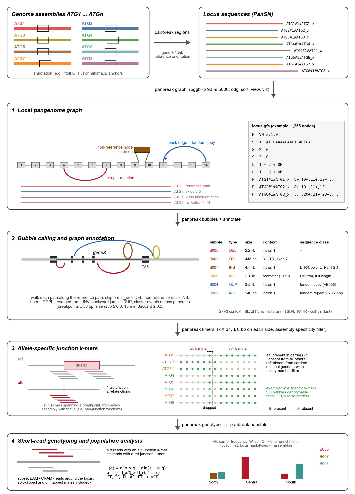
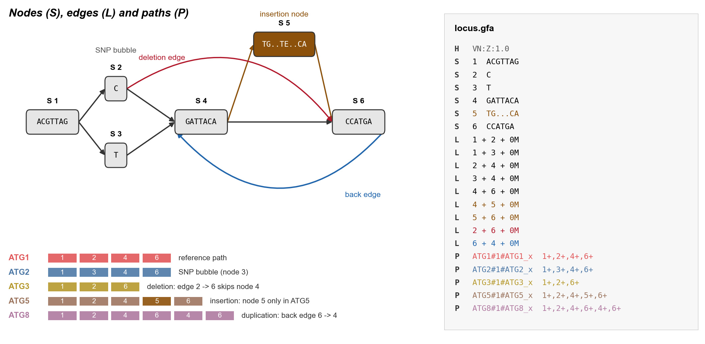
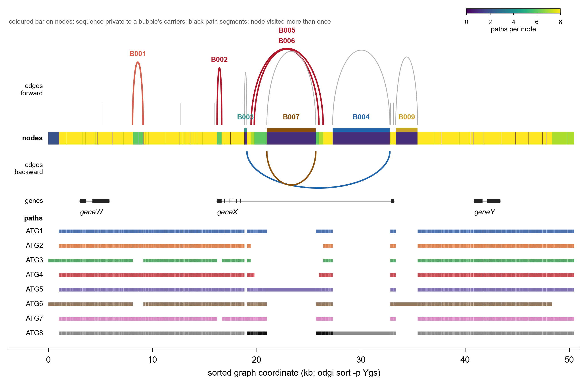
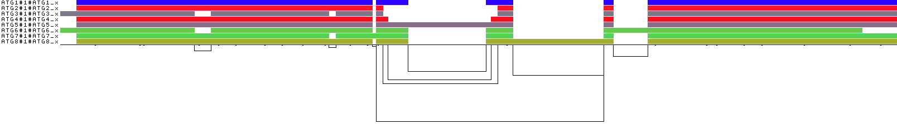
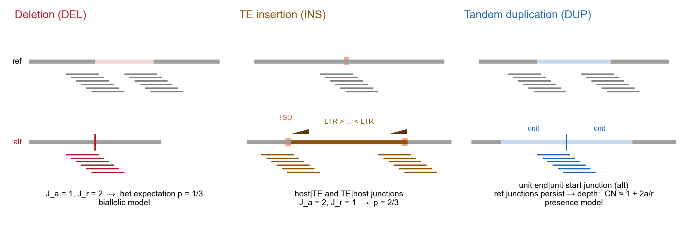
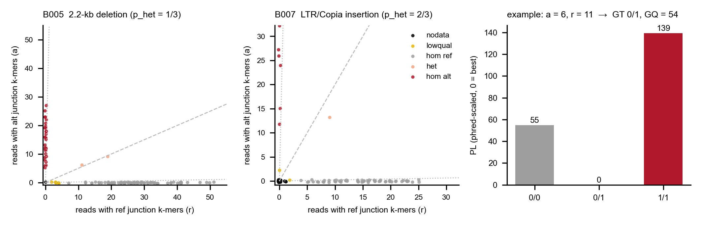
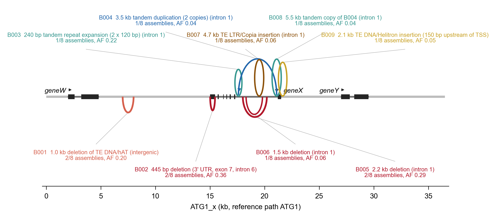
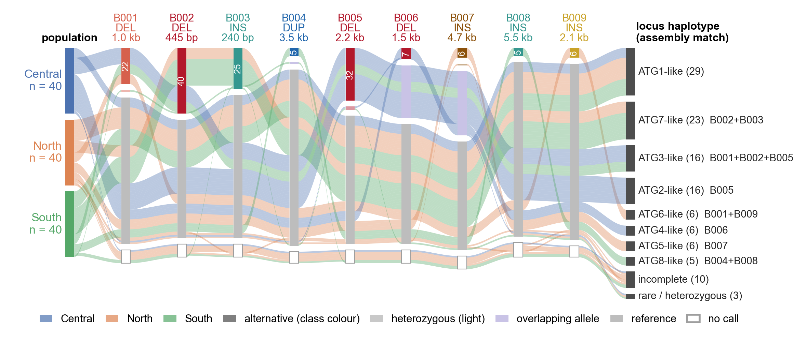
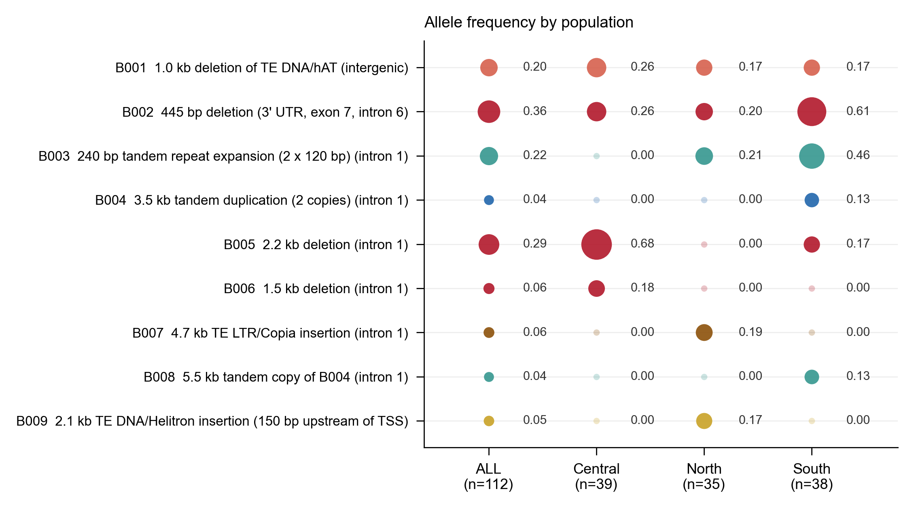
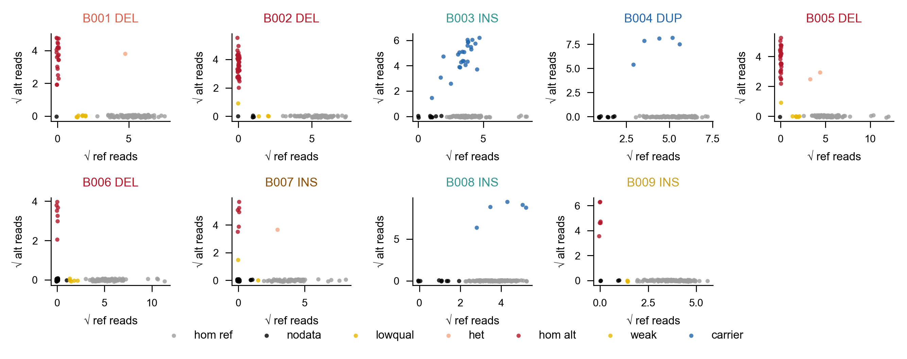

# PanBreak

[](https://github.com/yykaya/PanBreak/actions/workflows/tests.yml)
[](https://github.com/yykaya/PanBreak/releases)
[](https://www.python.org/)
[](environment.yml)
[](https://github.com/pangenome/pggb)
[](LICENSE)
[](https://github.com/yykaya/PanBreak/issues)

**Local pangenome graphs → annotated SV bubbles → junction k-mer genotyping of short-read cohorts**

PanBreak builds a pangenome graph of one locus from a set of genome assemblies and calls every
structural bubble in it. It annotates each bubble (deletions, insertions, transposable elements,
tandem duplications, repeat expansions) and turns the bubble breakpoints into allele-specific
**junction k-mers**. These k-mers then genotype the same alleles in hundreds to thousands of
short-read samples. The reads come straight from existing (subset) BAM/CRAM files, with no
re-alignment and no whole-genome graph index. The result is a population table of sequence-resolved
alleles: genotypes, allele frequencies, carrier frequencies, enrichment, F<sub>ST</sub> and locus
haplotypes that can be traced back to the assemblies.

PanBreak is a downstream genotyping module for pggb/odgi locus graphs. It complements graph
genotypers such as vg and PanGenie; it is not part of, or an official extension of, either project.
Feedback from the pggb, odgi and vg developers is welcome via GitHub issues.

PanBreak is under active development. Suggestions, bug reports and feature requests are very
welcome: please open a GitHub issue or contact the author directly (see [Contact](#contact)).

<p align="center"></p>

---

## Contents

1. [Motivation](#motivation)
2. [Installation](#installation)
3. [Quick start: the ATG1–ATG8 example](#quick-start-the-atg1atg8-example)
4. [Inputs](#inputs)
5. [The pipeline step by step](#the-pipeline-step-by-step)
6. [Output files](#output-files)
7. [Genotype model and metrics](#genotype-model-and-metrics)
8. [Population-level use of the output](#population-level-use-of-the-output)
9. [Running on a cohort / HPC](#running-on-a-cohort--hpc)
10. [Example results](#example-results)
11. [Limitations and good practice](#limitations-and-good-practice)
12. [Citation](#citation)
13. [Key citations](#key-citations)
14. [Acknowledgements and related tools](#acknowledgements-and-related-tools)
15. [Contact](#contact)

---

## Motivation

Long-read sequencing has become accurate and inexpensive. As a result, chromosome-level assemblies
and annotations are now available for many individuals of the same species, and attention has moved
from a single reference genome to the diversity among them. Comparing these assemblies shows that
many functionally important loci are hyper-variable. They carry transposable-element insertions,
deletions, tandem duplications, repeat expansions and replacements by highly diverged sequence,
often several alleles at the same site.

These alleles are now resolved in tens of assemblies. Their frequency in the much larger short-read
population collections, however, usually remains unknown. Genotyping the junctions that define them
is rarely done. Whole-genome graph construction and genome-wide graph genotyping are
computationally demanding, cost a lot to run for every new locus of interest, and are not tuned to
the complex alleles of a single region.

PanBreak addresses this gap. It builds a pangenome graph of only the locus of interest from all
available assemblies, annotates every structural bubble in that graph, and genotypes each allele in
thousands of short-read samples. It does so by counting allele-specific junction k-mers in reads that
were already aligned and subset to the locus. The result is a population-scale, sequence-resolved
view of structural and TE variation at the locus, obtained on a workstation in minutes rather than
with a genome-wide pipeline.

In short-read cohorts, three things make these alleles hard to genotype with standard tools:

* **Insertions are invisible to the linear reference.** Reads from an inserted TE do not map, or
  they map elsewhere. Only the reads that cross the host|TE boundary carry the evidence, and they
  appear as soft-clipped or unmapped mates.
* **Genome-wide SV genotypers are built for breadth.** Graph-based genotypers that use the whole
  genome (e.g. PanGenie, vg, BayesTyper, GraphTyper2) often return confident reference calls for
  complex, locus-specific alleles that are missing from, or collapsed in, the genome-wide graph or
  VCF.
* **Depth alone is ambiguous.** A coverage dip shows that something is missing, but not which
  allele, and not where its breakpoints are.

PanBreak takes a targeted route. It builds a **small, accurate graph of just the locus** from all
assemblies, calls and annotates the bubbles, and describes each allele by **the sequence that only
it contains**: the k-mers spanning its breakpoints. A read that carries such a k-mer is direct
evidence for that allele, wherever the aligner placed it.

### Why junction k-mers also genotype TE insertions

A transposable-element insertion makes two new junctions (`host | TE` and `TE | host`). It often
duplicates a short target site (TSD) on both sides. The TE body itself is repetitive and
uninformative, because copies of the same family exist across the genome. The junctions, however,
are unique to the inserted allele. The empty site has its own unique junction (`host | host`),
which is the reference allele. PanBreak therefore:

* takes the inserted sequence and its exact boundaries from the assemblies through the graph;
* classifies it against a TE library (family, superfamily, full length or not, LTR/TIR length,
  TSD);
* designs k-mers that are ≥ 8 bp into the host flank on one side and ≥ 8 bp into the TE (or the
  other flank) on the other;
* keeps only k-mers that appear in the carrier assemblies and in no other assembly.

The same logic applies to deletions of reference TEs, to TE-mediated replacements, and to tandem
duplications. For a tandem duplication the informative junction is `unit end | unit start`. In this
way, TE polymorphisms are genotyped as **specific, sequence-resolved alleles**, not as anonymous
"TE present nearby" calls. That makes it possible to follow a single insertion event through a
population, to separate independent insertions of the same family at nearby sites, and to
link short-read samples back to assembly haplotypes.

### Design principles

| Principle | How |
|---|---|
| Use all assemblies, not one reference | pggb graph of every haplotype; bubbles defined by walking every path |
| Alleles are sequences, not intervals | junction windows taken from every assembly that carries the allele ("pan-junction" k-mers) |
| Specificity is tested, not assumed | each k-mer is checked against every assembly (and optionally whole genomes) |
| Reads are evidence, wherever they map | k-mers are counted in all reads near the locus, including soft-clipped and unmapped mates |
| Calls are probabilistic | binomial genotype likelihoods, PL/GQ, VCF output |
| Population output is first-class | allele frequencies with CIs, enrichment tests, Hudson F<sub>ST</sub>, locus haplotypes |

---

## Installation

```bash
git clone https://github.com/yykaya/PanBreak.git
cd PanBreak
conda env create -f environment.yml
conda activate panbreak
panbreak --version
```

Without conda, install the Python package only and provide the external tools yourself:

```bash
python -m pip install -r requirements.txt
python -m pip install -e .
```

The conda environment (`environment.yml`) resolves on Linux (x86-64) and macOS (x86-64 and
arm64) from conda-forge and bioconda. It provides Python, pysam, numpy, matplotlib, samtools,
minimap2, BLAST+ and odgi. pggb is not part of the environment; run it from its container (below).

PanBreak itself needs only Python 3.9–3.12 with `pysam`, `numpy` and `matplotlib`. External tools:

| Tool | Used by | Notes |
|---|---|---|
| [pggb](https://github.com/pangenome/pggb) | `graph` | run through Docker / Singularity / Apptainer (default image is digest-pinned) or a native install |
| [odgi](https://github.com/pangenome/odgi) | `graph` | taken from the pggb container unless `--odgi` or `$ODGI` is set |
| minimap2 | `regions` (alignment mode) | only when assemblies have no annotation |
| BLAST+ (`blastn`, `makeblastdb`) | `annotate` | optional; without it a 21-mer containment search is used |
| samtools | example data, `workflow/subset_bams.sh` | |

pggb has no native macOS build. On a Mac, use Docker (e.g. `colima start --vm-type vz --vz-rosetta`)
and make sure the project folder is mounted in the VM.

---

## Quick start: the ATG1–ATG8 example

The example is fully synthetic and runs in about a minute. Eight assemblies (`ATG1` … `ATG8`) carry
a ~36-kb locus called `x` around the gene `geneX`; the locus sequence of genome `ATG1` is
`ATG1#1#ATG1_x`. `ATG4` and `ATG7` are assembled in reverse orientation, and `ATG8` sits on a
different contig with a 7-kb offset. The structural alleles are:

| Genome | Alleles built into the assembly |
|---|---|
| ATG1 | reference |
| ATG2 | 2.2-kb deletion in intron 1 |
| ATG3 | 2.2-kb intron-1 deletion + 445-bp 3' UTR deletion + loss of an intergenic hAT element |
| ATG4 | 1.5-kb deletion nested in the 2.2-kb one |
| ATG5 | 4.7-kb LTR/Copia insertion in intron 1 (300-bp LTRs, 5-bp TSD) |
| ATG6 | 2.1-kb Helitron 150 bp upstream of the TSS + loss of the hAT element |
| ATG7 | 445-bp 3' UTR deletion + 2 × 120-bp tandem repeat expansion |
| ATG8 | 4.5-kb tandem duplication (3 copies) |

The 120 short-read samples come from three populations (`North`, `Central`, `South`) with different
haplotype frequencies. Each sample has 8–25× (or 1.5×) coverage, 0.2 % sequencing error, private SNPs
and occasional heterozygosity. Reads are aligned to `ATG1` and the BAMs are subset to the locus.

```bash
cd example
python make_example.py          # assemblies, GFF3, TE library, 120 subset BAMs
bash run_example.sh             # all steps + evaluation against the simulated truth
```

---

## Inputs

| File | Format | Required by |
|---|---|---|
| `assemblies.tsv` | `genome`, `fasta`, optional `gff` (one row per assembly) | `regions` |
| assembly annotation | GFF3 with the target gene (e.g. liftoff output), or none (`--ref-locus` + minimap2) | `regions` |
| reference annotation | GFF3 of the reference genome (chromosome or locus coordinates) | `annotate`, `plot` |
| TE library | FASTA; names like `family#Class/Superfamily` (EDTA / RepeatModeler style) | `annotate` (optional) |
| alignments | BAM/CRAM per sample (whole-genome or subset), indexed; a folder, files, or a list | `genotype` |
| alignment reference | FASTA the reads were aligned to (enables read windows) | `genotype` (optional) |
| sample sheet | TSV with `sample` and a grouping column (`population`, `country`, …) | `popstats`, `plot` |

Sample names come from the `@RG SM` tag, or from the file name with `--sample-from file`.

---

## The pipeline step by step

### 1. `panbreak regions`: extract the locus from every assembly

```bash
panbreak regions -a assemblies.tsv -r ATG1 -g geneX -l x -f 15000 -o 01_regions
```

The gene is located in each assembly through its GFF3 (`ID`/`Name`; liftoff `_1` copy suffixes are
recognised). Without annotation, the reference locus is aligned with minimap2 (`--ref-locus
chr:start-end`, preset `asm20`). The region gene ± flank (or `--up/--down`, strand-aware) is cut out
and reverse-complemented when needed, so that every sequence is in reference orientation. Each one
is named in [PanSN](https://github.com/pangenome/PanSN-spec) form, `<genome>#1#<genome>_<locus>`.

Outputs: `locus.fa.gz` (bgzip + `.fai`), `regions/<genome>.fa`, and `regions.tsv` (assembly
coordinates, orientation, gene position inside each region, method).

### 2. `panbreak graph`: build the local graph (pggb → odgi)

```bash
panbreak graph -i 01_regions/locus.fa.gz -r ATG1 -e docker -t 8 -o 02_graph
```

This runs `pggb -n <haplotypes> -p 90 -s 5000 -V <ref>` (change with `-p`, `-s`, `--pggb-args`). It
then runs `odgi sort -p Ygs`, `odgi view -g`, `odgi stats` and three 1D `odgi viz` images (default,
depth `-m`, orientation `-z`). `--trim-up/--trim-down` restrict every path to the gene ± N bp with
`odgi extract -b` on a per-path BED. `--extend GENOME=bp` adds extra sequence for genomes with
tandem copies. `--layout` adds a 2D layout.

A few lines of the example graph (`02_graph/locus.gfa`, GFA 1.0):

```text
H   VN:Z:1.0
S   1   ATTCAAAACAACTCAGTCACTCACAGCCGACTGGGTTGGATCAACAAATACGAACG
S   2   G
S   3   C
L   1   +   2   +   0M
L   1   +   3   +   0M
P   ATG1#1#ATG1_x   8+,10+,11+,12+,14+,15+,17+,18+,20+,22+,23+,24+,...
P   ATG2#1#ATG2_x   8+,10+,11+,13+,14+,15+,17+,18+,20+,22+,23+,25+,...
P   ATG8#1#ATG8_x   8+,10+,11+,13+,14+,15+,17+,18+,20+,21+,23+,24+,...
```

`S` lines are nodes (sequence segments), `L` lines are edges, and each `P` line is one assembly's walk
through the graph. The schematic below shows how each class of variation appears in this model:

* a SNP is a two-node bubble;
* a deletion is an edge that skips nodes;
* an insertion is a node visited only by its carriers;
* a tandem duplication is a back edge that makes the carrier walk the same nodes twice.

<p align="center"><br>
<sub>Toy graph with six nodes. Coloured edges and nodes mark the structural alleles; each path lists the nodes an assembly visits.</sub></p>

`panbreak plot --gfa` draws the same elements for the real locus graph:

* nodes on the sorted graph coordinate, coloured by how many paths visit them;
* forward edges that skip sequence (above the nodes) and back edges (below the nodes);
* nodes private to a bubble's carriers;
* the walk of every assembly.

<p align="center"><br>
<sub>Example locus graph: 1D node layout with depth, carrier-specific edges and nodes coloured by bubble class, gene models projected through the reference path, and one row per assembly path (black: nodes visited twice in the tandem duplication).</sub></p>

<p align="center"><br>
<sub>The corresponding <code>odgi viz</code> image written by <code>panbreak graph</code>.</sub></p>

### 3. `panbreak bubbles`: call bubbles by walking every path

```bash
panbreak bubbles -g 02_graph/locus.gfa -r ATG1 --regions 01_regions/regions.tsv -o 03_bubbles
```

Every node on the reference path gets its reference coordinate(s). Every other path is then walked
in order. When a node occurs more than once on the reference (a collapsed repeat), the occurrence
nearest the walker's current position is used, which avoids false loops at repeat-flanked
breakpoints. Between two consecutive reference-anchored nodes:

| Observation (threshold `--min-sv`, default 50 bp) | Event |
|---|---|
| reference jump forward | **DEL** |
| non-reference nodes, no jump | **INS** |
| both | **REPL** (replacement) |
| both, mostly reference nodes in reverse orientation | **INV** |
| jump backwards | **DUP** (re-traversal of a tandem unit) |

Events from different assemblies are clustered into one bubble when they have the same type,
breakpoints within `--tolerance` (50 bp), size ratio ≥ 0.8, and, for inserted sequence, 15-mer
Jaccard ≥ 0.3. Two different TEs inserted at the same site therefore stay separate alleles. For
every bubble and assembly the status is:

* `1`: carrier
* `0`: reference allele
* `x`: carries a different, overlapping allele (e.g. a larger deletion)
* `.`: path does not span the bubble

Junction windows (± 60 bp) are written for **every** assembly that carries the allele (alt) and
every assembly with the reference allele (ref), not only for the reference genome.

### 4. `panbreak annotate`: annotate the graph bubbles

```bash
panbreak annotate -b 03_bubbles -r ATG1 --gff ATG1.gff3 --regions 01_regions/regions.tsv \
    --te-lib te_library.fa -t 8
```

| Annotation | Method |
|---|---|
| gene context | GFF3 lifted to locus coordinates: coding / UTR / exonic / intronic (numbered exon and intron) / promoter (≤ `--promoter`, 1 kb) / downstream / intergenic; signed distance to the nearest TSS |
| TE family and class | `blastn -task blastn -evalue 1e-10` against the TE library: best family by summed bit score, query coverage, subject coverage (full length if ≥ 0.8), identity; a 21-mer containment search if BLAST+ is absent |
| TSD | longest exact repeat (≥ 5 bp) flanking the TE hit, searched in the **carrier path** (pggb often collapses the TSD into a tiny re-traversal of reference nodes) |
| LTR / TIR | terminal direct repeat (diagonal identity ≥ 0.8 in 50-bp windows) / terminal inverted repeat |
| duplication | 21-mer hits of the allele sequence elsewhere in the reference path: *adjacent* → tandem; elsewhere → dispersed |
| tandem repeat / microsatellite | smallest period with ≥ 90 % self-identity (≤ 6 bp → microsatellite) |
| linked bubbles | an adjacent tandem-copy insertion with the same carriers as a DUP bubble is linked to it (pggb may represent 3 copies as one loop + one insertion) |

Every bubble gets an `sv_class` and a human-readable `label`, e.g. `4.7 kb TE LTR/Copia insertion
(intron 1)` or `2.1 kb TE DNA/Helitron insertion (150 bp upstream of TSS)`.

### 5. `panbreak kmers`: design allele-specific junction k-mers

```bash
panbreak kmers -b 03_bubbles --fasta 01_regions/locus.fa.gz -o 04_kmers
```

<p align="center"></p>

For every junction window, every k-mer (`-k 31`) that overlaps the breakpoint by at least
`--min-side` (8) bases on both sides is taken: 16 k-mers per window for k = 31. Identical k-mers from
different assemblies are merged. Each k-mer is then searched (both strands) in every assembly's
locus sequence:

* an **alt k-mer** is kept only if it occurs in at least one carrier and in **no** assembly with
  status `0` or `x`;
* a **ref k-mer** is kept only if it occurs in at least one reference-allele assembly and in **no**
  carrier. Presence-model bubbles are the exception, because their reference junctions also exist
  in carriers;
* optionally (`--background genome.fa ...`), k-mers that occur more than `--max-copies` times in any
  whole genome are removed.

The filtered k-mers are used to re-genotype the assemblies themselves (`assembly_kmer_genotypes.tsv`)
and the result is compared with the graph status: `asm_recall` (carriers recovered) and
`asm_false_carriers` (non-carriers hit). A bubble is genotypable when it has ≥ 1 specific alt
junction and ≥ 1 ref (or depth) junction.

**Two genotype models**

| Model | Bubbles | Ref junction meaning | Calls |
|---|---|---|---|
| `biallelic` | DEL, INS, REPL, INV | absent in carriers | 0/0, 0/1, 1/1 (or 0/1 haploid) |
| `presence` | DUP, adjacent tandem copies / repeat expansions | present in carriers too (local depth) | carrier / non-carrier + copy-number estimate |

### 6. `panbreak genotype`: count k-mers in reads and call genotypes

```bash
panbreak genotype -k 04_kmers -b 03_bubbles -B bams/ --bam-ref ATG1.fa --bam-region chr1:20000-80000 \
    --ploidy 2 -t 8 -o 05_genotypes
```

With `--bam-ref`, every bubble's reference junction windows are located (exact, unique match on
either strand) in the alignment reference. Reads are then fetched only within ± `--window` (300 bp)
of the breakpoints. Without it, all reads in the (subset) file are scanned. Primary reads of all
mapping qualities are used, including soft-clipped reads and unmapped mates placed at their mate's
position. Secondary, supplementary, QC-fail and duplicate reads are skipped; read pairs are counted
once per mate.

For each sample and bubble:

* **a** is the number of reads with ≥ 1 alt k-mer;
* **r** is the number of reads with ≥ 1 ref k-mer and no alt k-mer.

Per-junction read counts are reported as well, so that support from both TE junctions can be
checked.

### 7. `panbreak popstats`: population statistics

```bash
panbreak popstats -G 05_genotypes/genotypes.tsv -s samples.tsv -c population -b 03_bubbles -o 06_popstats
```

See [Population-level use of the output](#population-level-use-of-the-output).

### 8. `panbreak plot`

```bash
panbreak plot -b 03_bubbles -r ATG1 --gff ATG1.gff3 --gfa 02_graph/locus.gfa --regions 01_regions/regions.tsv \
    --genotypes 05_genotypes --popstats 06_popstats -s samples.tsv -o 07_plots
```

The command writes five plots:

* `locus_bubbles`: annotated bubble map, with arc width scaled by assembly carriers and labels
  showing assembly count and cohort AF;
* `graph_layout`: nodes, edges and paths of the locus graph, with bubble-specific edges and nodes
  highlighted;
* `haplotype_flow`: an alluvial diagram in which every sample flows from its population through its
  allele at each bubble (alternative, heterozygous, overlapping allele, reference, no call) into its
  locus haplotype and the matching assembly;
* `read_support`: √alt vs √ref reads per bubble, coloured by call;
* `population_af`: AF dot matrix.

### `panbreak merge`

`panbreak merge chunk_1 chunk_2 ... -b 03_bubbles -o 05_genotypes` combines genotype folders from
chunked runs into one set of matrices and one VCF.

---

## Output files

| Step | File | Content |
|---|---|---|
| regions | `regions.tsv` | genome, PanSN path, contig, start, end, orientation, gene position in the region, method |
| graph | `locus.gfa`, `locus.og`, `locus_stats.tsv`, `locus_1D*.png`, `pggb/` | sorted locus graph, odgi statistics and views, full pggb output (incl. the `-V` VCF) |
| bubbles | `bubbles.tsv` | bubble, type, pos/end (reference path; VCF-style anchor), ref_len, alt_len, copies, carriers, n_reference, n_other_allele, n_missing, representative, overlaps, chromosome coordinates |
| | `assembly_matrix.tsv` | genome × bubble status (`1`, `0`, `x`, `.`) |
| | `bubble_sequences.fa` | ref and alt allele sequences |
| | `bubble_junctions.tsv` | junction windows per allele, junction and source assembly |
| | `path_events.tsv`, `reference.fa`, `genome_paths.fa` | per-assembly events, reference path, all path sequences |
| annotate | `bubbles.annotated.tsv` | + context, context_detail, nearest_gene, tss_distance, alt_class, ref_class, te_family, te_class, te_cov, te_identity, full_length, ltr_len, tir_len, tsd, dup_frac, dup_where, motif, sv_class, label, linked |
| kmers | `junction_kmers.tsv` / `.fa` | bubble, allele, junction, source, offset, k-mer, canonical form, assembly counts |
| | `junction_summary.tsv` | model, junctions and k-mers per allele, expected het fraction, assembly recall, false carriers, genotypable |
| | `assembly_kmer_genotypes.tsv` | k-mer-based re-genotyping of the assemblies |
| genotype | `genotypes.tsv` | long table (columns below) |
| | `genotypes.vcf.gz` (+ `.tbi`) | VCF 4.3 with symbolic alleles `<DEL>`, `<INS>`, `<DUP:TANDEM>`, `<INV>`, `<CPX>`; INFO `SVTYPE`, `END`, `SVLEN`, `ALTLEN`, `SVCLASS`, `TE`, `CONTEXT`, `ASM_CARRIERS`, `MODEL`; FORMAT `GT:GQ:AD:DP:PL:FT:CN` |
| | `dosage_matrix.tsv`, `carrier_matrix.tsv` | sample × bubble (0/1/2 or 0/1; NA when not PASS) |
| | `sample_qc.tsv`, `read_windows.tsv` | reads scanned, call rate and median junction reads per sample; anchored windows |
| popstats | `population_frequencies.tsv`, `af_matrix.tsv` | per bubble × population (and ALL) |
| | `population_enrichment.tsv`, `pairwise_fst.tsv` | one-sided Fisher tests with BH q-values; Hudson F<sub>ST</sub> per bubble and across bubbles |
| | `sample_haplotypes.tsv`, `haplotype_frequencies.tsv` | locus haplotype per sample, matching assemblies, frequencies per population |

`genotypes.tsv` columns:

| Column | Meaning |
|---|---|
| `alt_reads`, `ref_reads` | **a**, **r** |
| `alt_fraction` | a / (a + r) |
| `alt_junction_reads`, `ref_junction_reads` | reads per junction (e.g. `21,18` = both TE junctions supported) |
| `GT`, `GQ`, `PL` | genotype, quality, phred-scaled likelihoods |
| `FT` | `PASS`, `LowAltSupport`, `LowRefSupport`, `LowGQ`, `NoData` |
| `call` | `hom_ref`, `het`, `hom_alt`, `carrier`, `weak`, `lowqual`, `nodata` |
| `dosage`, `carrier` | numeric genotype (PASS only) |
| `copy_estimate` | presence model: 1 + 2a/r |

---

## Genotype model and metrics

<p align="center"></p>

**Allele balance.** With J<sub>a</sub> alt junctions and J<sub>r</sub> ref junctions that have
specific k-mers, a heterozygote is expected to show an alt read fraction of

&nbsp;&nbsp;&nbsp;&nbsp;p<sub>het</sub> = J<sub>a</sub> / (J<sub>a</sub> + J<sub>r</sub>)

This is 1/3 for a deletion (1 new junction, 2 lost) and 2/3 for an insertion (2 new junctions, 1 lost).
Using this expected fraction, rather than 0.5, avoids systematic het/hom errors.

**Likelihood.** For genotype g with expected alt fraction p<sub>g</sub> ∈ {ε, p<sub>het</sub>, 1 − ε}
(ε = `--error`, 0.02):

&nbsp;&nbsp;&nbsp;&nbsp;log L(g) = a · ln p<sub>g</sub> + r · ln(1 − p<sub>g</sub>)

PL = −10 log<sub>10</sub>(L(g) / L<sub>max</sub>). GT is the genotype with PL = 0, and GQ is the
second-smallest PL (capped at 99). With `--ploidy 1` (inbred or selfing lines, haploid organisms)
only {ε, 1 − ε} are used.

**Filters.**

* An alt-containing genotype needs a ≥ `--min-alt` (2), a hom-ref needs r ≥ `--min-ref` (2), and every
  call needs GQ ≥ `--min-gq` (10).
* a + r < `--min-depth` gives `nodata`, or `weak` when a single alt read is present.

**Presence model (tandem duplications, repeat expansions).**

* A sample is a carrier when a ≥ `--min-alt`.
* A non-carrier needs a = 0 and r ≥ `--min-ref`, with GQ = 10 · (r/2) / ln 10. This is the phred
  probability of seeing no junction read if one tandem junction were present at the local depth.
* `copy_estimate` = 1 + 2a/r, because the `unit end | unit start` junction occurs (copies − 1) times
  per haplotype and each reference junction once.

| Metric | Where | Definition |
|---|---|---|
| call rate | popstats, sample_qc | PASS calls / samples (samples carrying an overlapping allele count as called non-carriers) |
| AF | popstats | (2·hom_alt + het) / (2·called) for diploid biallelic; carriers / called for ploidy 1 or presence |
| AF_lo95 / AF_hi95 | popstats | Wilson score interval |
| carrier_freq | popstats | carriers / called |
| exp_het, obs_het, F_IS | popstats | 2p(1 − p), observed het fraction, 1 − H<sub>o</sub>/H<sub>e</sub> (≈ 1 in selfers) |
| odds_ratio, p/q_enrichment | popstats | carriers in a population vs all others, one-sided Fisher exact test, Benjamini–Hochberg |
| Fst | popstats | Hudson estimator per bubble; ratio of averages across bubbles (`bubble = ALL`) |
| asm_recall, asm_false_carriers | kmers | k-mer re-genotyping of the assemblies against the graph status |

---

## Population-level use of the output

* **Allele frequencies with uncertainty.** Use `population_frequencies.tsv` and `af_matrix.tsv` for
  maps, pie charts, or clines along environmental gradients (join on population/site
  coordinates).
* **Overlapping alleles are resolved.** A sample with the 2.2-kb deletion cannot show the junctions
  of the nested 1.5-kb deletion or of an insertion inside it. Such no-calls are recognised from the
  `overlaps` column and counted as non-carriers of the nested allele rather than as missing data.
  `--no-overlap-rescue` turns this off.
* **Locus haplotypes.** `sample_haplotypes.tsv` combines all PASS calls into one string per sample
  (`REF`, `B005`, `B001+B002+B005`, `B007(het)` …). `matching_assemblies` names the assemblies with
  the same bubble combination, so that every short-read sample is linked to a sequence-resolved
  assembly haplotype. Incomplete haplotypes end in `?`.
* **Association and structure.** `dosage_matrix.tsv` and `carrier_matrix.tsv` drop straight into
  GWAS/GEA covariates, PCA overlays or mixed models. `genotypes.vcf.gz` can be merged with SNP
  VCFs (`bcftools concat/merge`) or read by PLINK.
* **Differentiation and enrichment.** `pairwise_fst.tsv` and `population_enrichment.tsv` give
  population-specific alleles with multiple-testing control.
* **QC.** Use `sample_qc.tsv` (reads scanned, call rate, median junction reads) to drop low-coverage
  samples. `read_support.png` shows whether hom/het clusters separate cleanly for each bubble.

---

## Running on a cohort / HPC

1. **Subset alignments** around the locus (± 20 kb is plenty; unmapped mates placed at their mate's
   position are kept by `samtools view <region>`):
   ```bash
   bash workflow/subset_bams.sh bam_list.txt chr1:1200000-1350000 subset_bams/ 16
   ```
2. **Graph and k-mers** once, on a workstation (`workflow/run_panbreak.sh config.sh` runs everything;
   see `workflow/config.example.sh`).
3. **Genotype in chunks** with a SLURM array, then merge:
   ```bash
   jid=$(sbatch --parsable --array=1-20 --export=ALL,BAM_LIST=bams.txt,KMERS=04_kmers,BUBBLES=03_bubbles workflow/panbreak_genotype.slurm)
   sbatch --dependency=afterok:$jid --wrap "panbreak merge 05_genotypes/chunks/chunk_* -b 03_bubbles -o 05_genotypes"
   ```

Speed: genotyping is a hash look-up per read k-mer. In the example, 120 subset BAMs are genotyped in
about 1.5 s on 8 cores. A subset BAM of a few thousand reads takes milliseconds, so thousands of
samples finish in minutes.

---

## Example results

`bash example/run_example.sh`. The figures below are produced by the run itself.

**Graph and bubbles.**

* The 8 locus sequences (34–46 kb) form a graph of 50.5 kb and ~1,250 nodes (pggb runs differ by a few nodes).
* Walking the paths gives 12 events, clustered into 9 bubbles: 4 DEL, 4 INS, 1 DUP.
* The 3-copy tandem duplication appears as one loop (B004) plus a linked tandem-copy insertion
  (B008).

<p align="center"></p>

**Annotation recovered the simulated structures:**

* the LTR/Copia element is full length, with 299-bp LTRs (300 simulated) and its TSD;
* the Helitron is full length, has no TSD, and sits 150 bp upstream of the TSS;
* the intergenic hAT loss is classified as a deletion of a DNA/hAT element, with its 16-bp TIR;
* the 2 × 120-bp intronic expansion is classified as a tandem repeat;
* the 445-bp deletion is placed in the 3' UTR / exon 7.

**K-mers.** 494 specific 31-mers were kept, and all 9 bubbles are genotypable. Re-genotyping the
assemblies with these k-mers gave a recall of 1.0 and 0 false carriers.

**Genotypes vs simulated truth** (`example/results/evaluation.tsv`, 120 samples × 9 bubbles):

| | value |
|---|---|
| PASS calls | 937 / 1,080 |
| no-calls explained by an overlapping allele (nested deletion / insertion inside a deletion) | 77 |
| other no-calls | mostly the 8 samples at 1.5× coverage |
| genotype concordance of PASS calls | 99.89 % (936 / 937) |
| carrier sensitivity | 100 % |
| false carriers | 0 |

**Population signal.**

* All 8 assembly haplotypes are recovered from short reads at the simulated frequencies.
* Population-specific alleles stand out:
  * B005 in `Central`: AF 0.68, q = 3 × 10<sup>−9</sup>;
  * B003 and B002 in `South`;
  * B007 and B009 only in `North`.

<p align="center"><br>
<sub>Haplotype flow: 120 short-read samples from three populations pass through their genotype at each bubble and end in the locus haplotype they share with an assembly (ATG1-like = reference haplotype).</sub></p>
<p align="center"></p>
<p align="center"></p>

---

## Limitations and good practice

* **Assembly panel.** Only alleles present in the assemblies can be genotyped. Unknown alleles at
  the same breakpoints appear as `nodata` or `weak`; inspect them with `read_support`, or add the
  missing assemblies.
* **Graph parameters.** For divergent loci, lower `-p` (e.g. 85) and keep `-s` larger than the
  largest TE you expect to align. Check `locus_1D.png` before trusting the bubble calls.
* **Collapsed repeats and tandem copies.** pggb may represent multi-copy tandem arrays as
  loops plus insertions. PanBreak links them (`linked`), but copy numbers from short reads are
  estimates.
* **Multi-copy junctions.** For TE-rich genomes, run `kmers --background` with whole-genome
  assemblies of a few non-carriers. This removes junction k-mers that also occur elsewhere in the
  genome, e.g. at older insertions of the same family next to similar host sequence.
* **Reference bias at the read level.** k-mer counting does not depend on where reads were placed,
  but reads must be present in the BAM. Subset generously (≥ 10 kb beyond the outermost bubble) and
  keep unmapped mates.
* **Selfing species.** Use `--ploidy 1` when residual heterozygosity is negligible; F<sub>IS</sub>
  from diploid calls is reported anyway.

---

## Citation

If you use PanBreak, please cite it as:

> Kaya, Y. (2026). *PanBreak: local pangenome graph bubble annotation and junction k-mer genotyping
> of structural variants and TE insertions from short reads* (Version 0.1.0) [Computer software].
> GitHub. https://github.com/yykaya/PanBreak

```bibtex
@software{kaya2026panbreak,
  author  = {Kaya, Yasin},
  title   = {PanBreak: local pangenome graph bubble annotation and junction k-mer genotyping of structural variants and TE insertions from short reads},
  year    = {2026},
  version = {0.1.0},
  url     = {https://github.com/yykaya/PanBreak}
}
```

Machine-readable metadata is in [`CITATION.cff`](CITATION.cff). Please also cite the tools PanBreak
builds on, listed under [Key citations](#key-citations).

---

## Key citations

Graph construction and manipulation (used by `panbreak graph`):

* **pggb.** Garrison E, Guarracino A, Heumos S, *et al.* Building pangenome graphs. *Nat Methods* **21**, 2008–2012 (2024). doi:[10.1038/s41592-024-02430-3](https://doi.org/10.1038/s41592-024-02430-3)
* **odgi.** Guarracino A, Heumos S, Nahnsen S, Prins P, Garrison E. ODGI: understanding pangenome graphs. *Bioinformatics* **38**, 3319–3326 (2022). doi:[10.1093/bioinformatics/btac308](https://doi.org/10.1093/bioinformatics/btac308)
* **seqwish.** Garrison E, Guarracino A. Unbiased pangenome graphs. *Bioinformatics* **39**, btac743 (2023). doi:[10.1093/bioinformatics/btac743](https://doi.org/10.1093/bioinformatics/btac743)
* **wfmash / WFA.** <https://github.com/waveygang/wfmash>; Marco-Sola S, Moure JC, Moreto M, Espinosa A. Fast gap-affine pairwise alignment using the wavefront algorithm. *Bioinformatics* **37**, 456–463 (2021). doi:[10.1093/bioinformatics/btaa777](https://doi.org/10.1093/bioinformatics/btaa777)
* **smoothxg.** <https://github.com/pangenome/smoothxg>

Alignment, sequence and annotation tools:

* **SAMtools/BCFtools (htslib).** Danecek P, Bonfield JK, Liddle J, *et al.* Twelve years of SAMtools and BCFtools. *GigaScience* **10**, giab008 (2021). doi:[10.1093/gigascience/giab008](https://doi.org/10.1093/gigascience/giab008)
* **pysam.** <https://github.com/pysam-developers/pysam>
* **minimap2.** Li H. Minimap2: pairwise alignment for nucleotide sequences. *Bioinformatics* **34**, 3094–3100 (2018). doi:[10.1093/bioinformatics/bty191](https://doi.org/10.1093/bioinformatics/bty191)
* **BLAST+.** Camacho C, Coulouris G, Avagyan V, *et al.* BLAST+: architecture and applications. *BMC Bioinformatics* **10**, 421 (2009). doi:[10.1186/1471-2105-10-421](https://doi.org/10.1186/1471-2105-10-421)
* **Liftoff** (suggested for annotating assemblies). Shumate A, Salzberg SL. Liftoff: accurate mapping of gene annotations. *Bioinformatics* **37**, 1639–1643 (2021). doi:[10.1093/bioinformatics/btaa1016](https://doi.org/10.1093/bioinformatics/btaa1016)

Graph and k-mer genotyping (related approaches):

* **vg.** Garrison E, Sirén J, Novak AM, *et al.* Variation graph toolkit improves read mapping by representing genetic variation in the reference. *Nat Biotechnol* **36**, 875–879 (2018). doi:[10.1038/nbt.4227](https://doi.org/10.1038/nbt.4227)
* **vg SV genotyping.** Hickey G, Heller D, Monlong J, *et al.* Genotyping structural variants in pangenome graphs using the vg toolkit. *Genome Biol* **21**, 35 (2020). doi:[10.1186/s13059-020-1941-7](https://doi.org/10.1186/s13059-020-1941-7)
* **vg giraffe.** Sirén J, *et al.* Pangenomics enables genotyping of known structural variants in 5202 diverse genomes. *Science* **374**, abg8871 (2021).
* **PanGenie.** Ebler J, Ebert P, Clarke WE, *et al.* Pangenome-based genome inference allows efficient and accurate genotyping across a wide spectrum of variant classes. *Nat Genet* **54**, 518–525 (2022). doi:[10.1038/s41588-022-01043-w](https://doi.org/10.1038/s41588-022-01043-w)
* **BayesTyper.** Sibbesen JA, Maretty L, Krogh A. Accurate genotyping across variant classes and lengths using variant graphs. *Nat Genet* **50**, 1054–1059 (2018).
* **GraphTyper2.** Eggertsson HP, *et al.* GraphTyper2 enables population-scale genotyping of structural variation using pangenome graphs. *Nat Commun* **10**, 5402 (2019).
* **TEPID.** Stuart T, *et al.* Population scale mapping of transposable element diversity reveals links to gene regulation and epigenomic variation. *eLife* **5**, e20777 (2016).
* **MELT.** Gardner EJ, *et al.* The Mobile Element Locator Tool (MELT). *Genome Res* **27**, 1916–1929 (2017).

Statistics:

* Hudson RR, Slatkin M, Maddison WP. Estimation of levels of gene flow from DNA sequence data. *Genetics* **132**, 583–589 (1992).
* Bhatia G, Patterson N, Sankararaman S, Price AL. Estimating and interpreting F<sub>ST</sub>: the impact of rare variants. *Genome Res* **23**, 1514–1521 (2013).
* Wilson EB. Probable inference, the law of succession, and statistical inference. *J Am Stat Assoc* **22**, 209–212 (1927).
* Benjamini Y, Hochberg Y. Controlling the false discovery rate. *J R Stat Soc B* **57**, 289–300 (1995).

---

## Acknowledgements and related tools

We thank the developers of the upstream and foundational projects that PanBreak builds on:
Erik Garrison ([@ekg](https://github.com/ekg)), Andrea Guarracino
([@AndreaGuarracino](https://github.com/AndreaGuarracino)) and the contributors of the
[pangenome](https://github.com/pangenome) organisation, and the [vg team](https://github.com/vgteam).

* [pggb](https://github.com/pangenome/pggb), which builds the locus graphs;
* [odgi](https://github.com/pangenome/odgi), which sorts, extracts and visualises them;
* [seqwish](https://github.com/ekg/seqwish), [wfmash](https://github.com/waveygang/wfmash) and
  [smoothxg](https://github.com/pangenome/smoothxg), the graph induction, alignment and
  normalisation steps inside pggb;
* [vg](https://github.com/vgteam/vg), the variation graph toolkit that the GFA path model and graph
  genotyping build on.

PanBreak is an independent downstream module for pggb/odgi locus graphs and is not affiliated with
these projects. Feedback from their developers is welcome via GitHub issues.

## Contact

PanBreak is under active development. Suggestions, bug reports and feature requests are very
welcome: please open a GitHub issue or contact the author directly.

Yasin Kaya: yyasinkkaya@gmail.com, ykaya@mpipz.mpg.de

---

## License

MIT, see [LICENSE](LICENSE).
